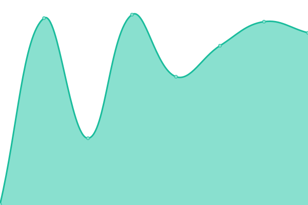
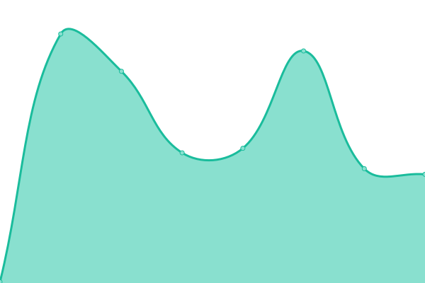
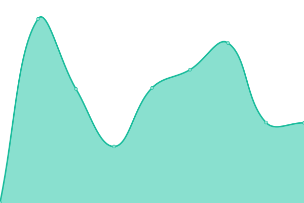
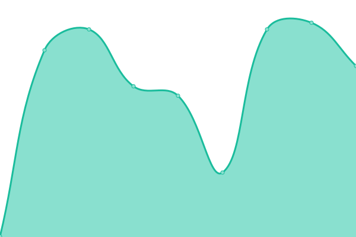

# [📈 Live Status](https://status.stephens.link): <!--live status--> **🟧 Partial outage**

This repository contains the open-source uptime monitor and status page for [Greg Stephens](http://gstephens.org), powered by [Upptime](https://github.com/upptime/upptime).

With [Upptime](https://upptime.js.org), you can get your own unlimited and free uptime monitor and status page, powered entirely by a GitHub repository. We use [Issues](https://github.com/rgstephens/upptime/issues) as incident reports, [Actions](https://github.com/rgstephens/upptime/actions) as uptime monitors, and [Pages](https://status.stephens.link) for the status page.

<!--start: status pages-->
<!-- This summary is generated by Upptime (https://github.com/upptime/upptime) -->
<!-- Do not edit this manually, your changes will be overwritten -->
<!-- prettier-ignore -->
| URL | Status | History | Response Time | Uptime |
| --- | ------ | ------- | ------------- | ------ |
|  [tonk.link](https://tonk.link) | 🟥 Down | [tonk-link.yml](https://github.com/rgstephens/upptime/commits/HEAD/history/tonk-link.yml) | 

 0ms
     
 | 

<a href="https://rgstephens.github.io/upptime/history/tonk-link">99.75%</a>
    

|  [play.tonk.link](https://play.tonk.link) | 🟥 Down | [play-tonk-link.yml](https://github.com/rgstephens/upptime/commits/HEAD/history/play-tonk-link.yml) | 

 0ms
     
 | 

<a href="https://rgstephens.github.io/upptime/history/play-tonk-link">99.80%</a>
    

|  [Golftrip](https://golftrip.link) | 🟩 Up | [golftrip.yml](https://github.com/rgstephens/upptime/commits/HEAD/history/golftrip.yml) | 

 0ms
     
 | 

<a href="https://rgstephens.github.io/upptime/history/golftrip">100.00%</a>
    

|  [Avkana](https://avkana.com) | 🟩 Up | [avkana.yml](https://github.com/rgstephens/upptime/commits/HEAD/history/avkana.yml) | 

 0ms
     
 | 

<a href="https://rgstephens.github.io/upptime/history/avkana">100.00%</a>
    

|  [gstephens](https://gstephens.org) | 🟥 Down | [gstephens.yml](https://github.com/rgstephens/upptime/commits/HEAD/history/gstephens.yml) | 

 0ms
     
 | 

<a href="https://rgstephens.github.io/upptime/history/gstephens">99.85%</a>
    

|  [FishOn](https://fishonwithjon.com) | 🟥 Down | [fish-on.yml](https://github.com/rgstephens/upptime/commits/HEAD/history/fish-on.yml) | 

 0ms
     
 | 

<a href="https://rgstephens.github.io/upptime/history/fish-on">0.00%</a>
    

|  [TourneyCard](https://tourneycard.com) | 🟥 Down | [tourney-card.yml](https://github.com/rgstephens/upptime/commits/HEAD/history/tourney-card.yml) | 

 0ms
     
 | 

<a href="https://rgstephens.github.io/upptime/history/tourney-card">99.90%</a>
    

|  [TourneyCard Scoring](https://tourneycard.com/scoring) | 🟥 Down | [tourney-card-scoring.yml](https://github.com/rgstephens/upptime/commits/HEAD/history/tourney-card-scoring.yml) | 

 0ms
     
 | 

<a href="https://rgstephens.github.io/upptime/history/tourney-card-scoring">99.95%</a>
    

|  [TripTrak](https://triptrak.link) | 🟥 Down | [trip-trak.yml](https://github.com/rgstephens/upptime/commits/HEAD/history/trip-trak.yml) | 

 0ms
     
 | 

<a href="https://rgstephens.github.io/upptime/history/trip-trak">100.00%</a>
    

|  [Simply Spaces](https://simply-spaces.com) | 🟩 Up | [simply-spaces.yml](https://github.com/rgstephens/upptime/commits/HEAD/history/simply-spaces.yml) | 

 0ms
     
 | 

<a href="https://rgstephens.github.io/upptime/history/simply-spaces">100.00%</a>
    

<!--end: status pages-->

[**Visit our status website →**](https://status.stephens.link)

## 📄 License

- Powered by: [Upptime](https://github.com/upptime/upptime)
- Code: [MIT](./LICENSE) © [Greg Stephens](http://gstephens.org)
- Data in the `./history` directory: [Open Database License](https://opendatacommons.org/licenses/odbl/1-0/)
